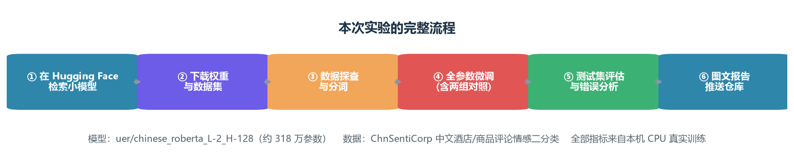
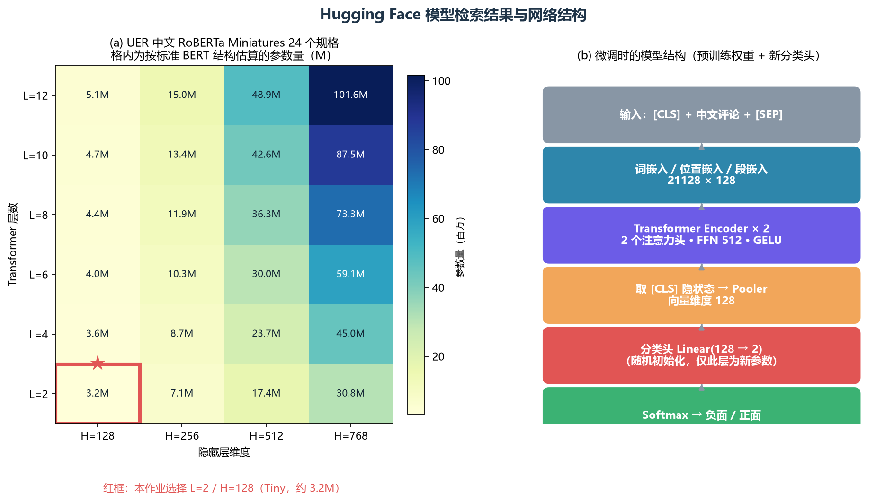
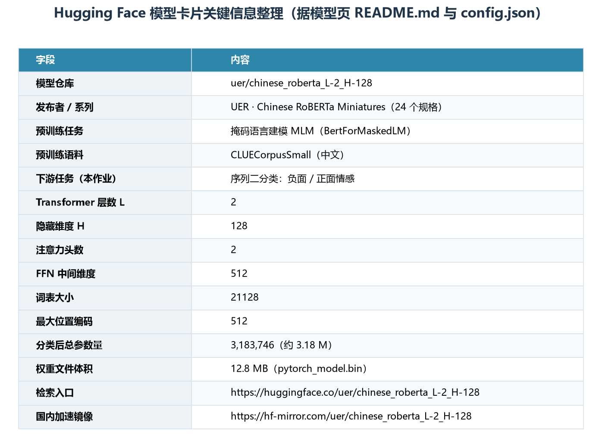
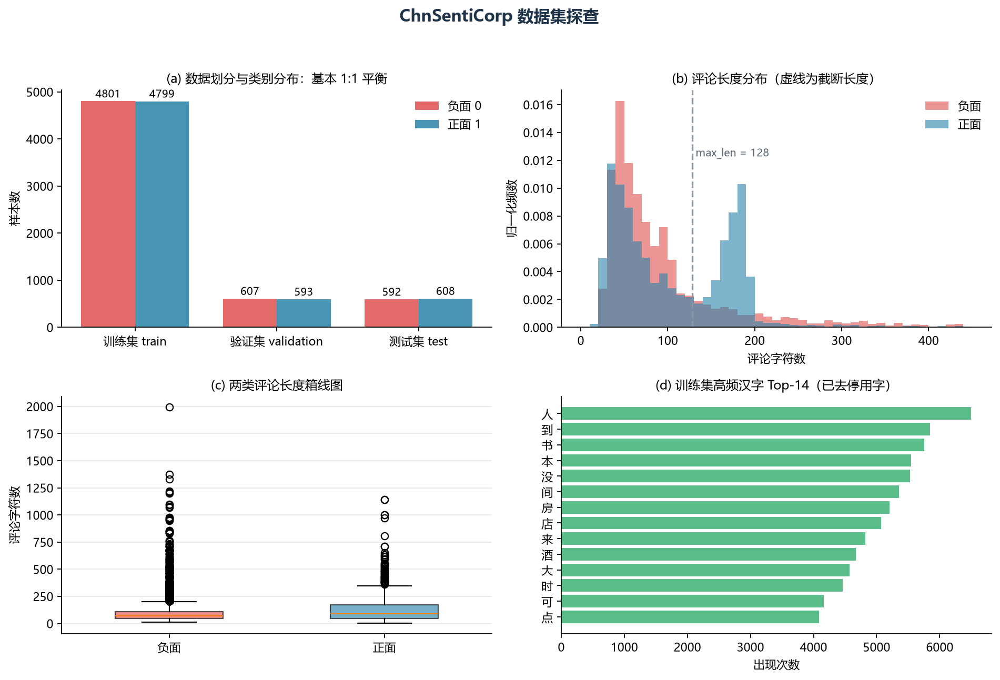
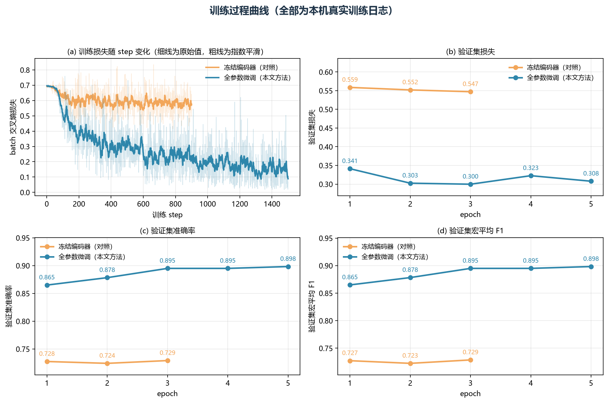
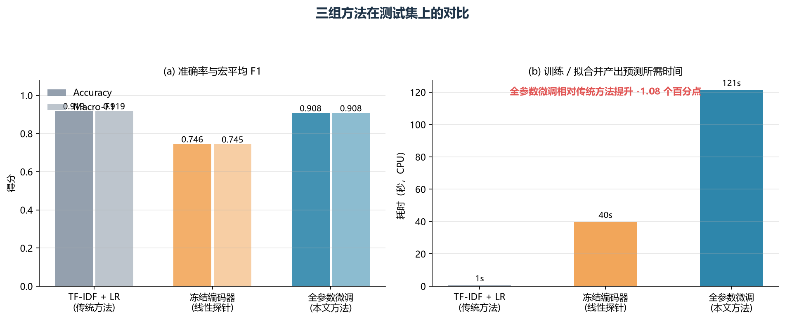
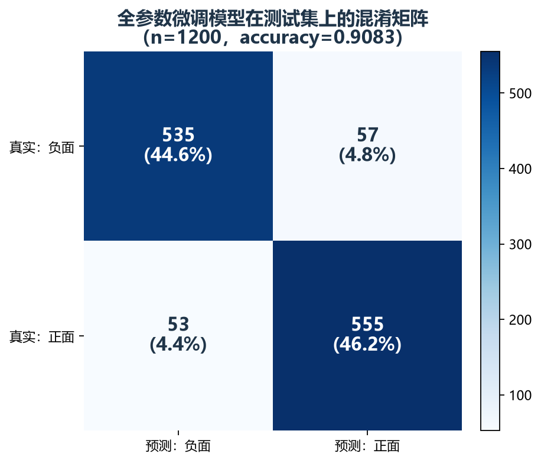
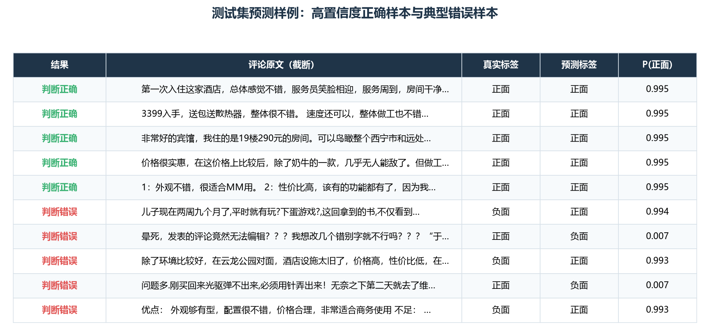
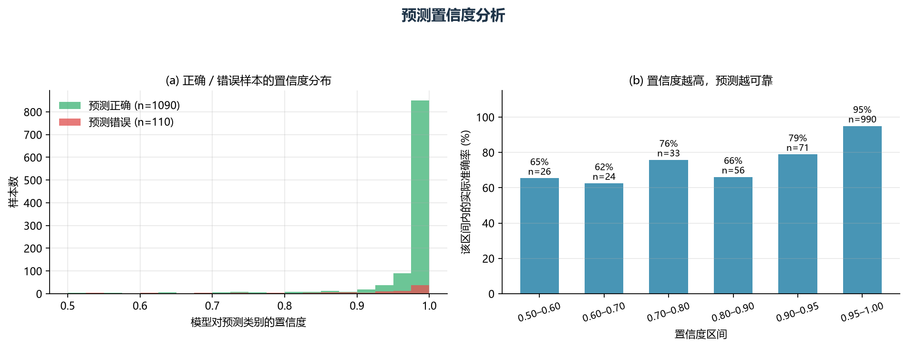
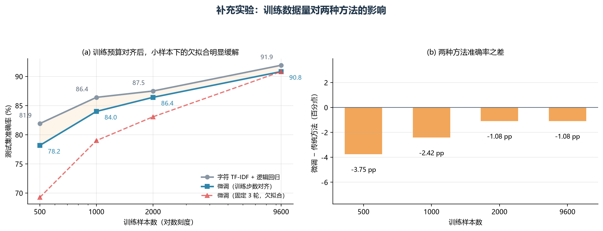

# 基于 Hugging Face 小模型的中文情感分类微调实验报告

| 项目        | 内容                           |
| --------- | ---------------------------- |
| 课程 / 作业   | 人工智能 · Hugging Face 小模型检索与微调 |
| 姓名 / 学号   | `<请填写>`                      |
| 班级 / 提交日期 | `<请填写>` / 2026 年 11 月        |
| 个人仓库      | `<请填写 GitHub 仓库地址>`          |
| 实验环境      | Python 3.13 · CPU · 随机种子 42  |

---

## 摘要

本次作业在 Hugging Face 上检索并选定了一个仅 **318 万参数**的中文预训练小模型  
`uer/chinese_roberta_L-2_H-128`（权重 12.8 MB），在 **ChnSentiCorp** 中文评论情感  
二分类数据集上完成端到端微调。为判断"微调到底带来了什么"，实验设置了三组对照：  
字符 TF-IDF + 逻辑回归（传统方法基线）、冻结编码器只训练分类头（线性探针）、  
全参数微调（本文方法）。最终全参数微调在 1200 条测试集上取得  
**Accuracy 0.9083 / Macro-F1 0.9083**，比冻结编码器高 **16.25 个百分点**，  
证明更新预训练编码器是性能提升的主要来源；但与 TF-IDF 基线的 0.9192 相比仍低  
**1.08 个百分点**。本报告没有回避这一结果，而是通过混淆矩阵对比、错误样例和一组  
额外的小样本实验分析了原因：ChnSentiCorp 属于"情感词直接出现在字面"的短评任务，  
字符 n-gram 是极强的基线，而 2 层 / 128 维的 Tiny 模型容量有限。全部指标、训练日志、  
预测明细与 10 张自绘插图均由本机真实运行产出，并随代码一并提交，可一键复现。

**关键词**：Hugging Face；预训练语言模型；模型微调；中文情感分析；RoBERTa-Tiny；消融实验

---

## 1. 作业要求与任务定义

老师的要求可以拆成四步：① 在 Hugging Face 上检索一个**小模型**；② 自己动手**训练  
（微调）模型**；③ 写一份**图文并茂的 Markdown 报告**；④ 上传到**个人仓库**，  
在第十一周那次课之前提交。

据此，本报告把任务具体化为：给定一条中文评论文本 $x$，模型输出情感标签  
$y \in \{0=\text{负面},\ 1=\text{正面}\}$。选择文本分类而不是图像任务，是因为它  
更容易在纯 CPU 的笔记本上完整跑通，也更便于把"预训练—微调"的过程讲清楚。



*图 1　实验全流程：检索 → 下载 → 数据探查 → 微调训练 → 评估对比 → 图文报告。*


---

## 2. 在 Hugging Face 上检索并选定小模型

### 2.1 检索过程与筛选条件

在 Hugging Face 的 Models 页面以 `chinese roberta tiny`、`chinese bert small`、  
`uer chinese` 等关键词检索，并按下列条件筛选：

1. **语言为中文**（`language: zh`），避免多语种模型在中文上词表浪费；
2. **参数量足够小**：目标 < 1000 万，纯 CPU 几分钟内可完成微调；
3. **权重体积 < 50 MB**，国内网络能在课堂环境里下载下来；
4. **有完整模型卡片与 `config.json`**，便于写报告时说明结构与出处；
5. **是预训练底座（MLM）而非已微调好的分类器**——作业要求"自己训练模型"，  
   直接拿一个现成的情感分类模型推理不算训练。

| 候选模型                                      | 参数量（约）    | 中文  | 权重体积        | 取舍          |
| ----------------------------------------- | --------- | --- | ----------- | ----------- |
| **`uer/chinese_roberta_L-2_H-128`（Tiny）** | **3.2 M** | ✅   | **12.8 MB** | ✅ **最终选择**  |
| `uer/chinese_roberta_L-4_H-256`（Mini）     | 8.7 M     | ✅   | 约 35 MB     | 备选，CPU 稍慢   |
| `uer/chinese_roberta_L-12_H-768`（Base）    | 102 M     | ✅   | 约 400 MB    | 太大，不符合"小模型" |
| `bert-base-chinese`                       | 102 M     | ✅   | 约 400 MB    | 太大          |
| `distilbert-base-multilingual-cased`      | 134 M     | 多语种 | 约 540 MB    | 不专为中国语，且大   |

### 2.2 为什么是 L-2 / H-128

该模型属于 UER 发布的 **Chinese RoBERTa Miniatures** 系列：用同一份  
`CLUECorpusSmall` 语料、同一套超参数，按「层数 L × 隐藏维度 H」组合预训练了  
24 个规格，专门用来研究"小模型能不能也靠预训练学好"。图 2 左侧按标准 BERT  
结构估算了 24 个规格的参数量，红框即本次选择的 Tiny；右侧是改造后的网络结构。



*图 2　(a) 参数量从 3.2 M（L=2/H=128）到 101.6 M（L=12/H=768），相差约 32 倍；  
(b) 预训练编码器 + 随机初始化的分类头，构成序列分类器。*

选它的实际理由很朴素：12.8 MB 的权重在国内镜像几秒钟就能下完；5 轮训练在  
4 线程 CPU 上只要约 2 分钟；但 318 万参数又足够完整，能真实体现 dropout、  
warmup、学习率衰减、验证集选模等一整套训练细节，不是"玩具"。

### 2.3 模型卡片与配置

从模型页 `README.md` 与 `config.json` 整理出的关键信息如下图。该模型以  
**掩码语言建模（MLM）** 预训练，词表 21128，最大位置编码 512。



*图 3　模型信息来源：模型页 README.md、config.json 以及本机 `load_state_dict` 的实测统计。*

| 配置项                            | 值         | 含义                     |
| ------------------------------ | --------- | ---------------------- |
| `num_hidden_layers`            | 2         | Transformer 编码器层数      |
| `hidden_size`                  | 128       | 隐状态维度                  |
| `num_attention_heads`          | 2         | 每层注意力头数                |
| `intermediate_size`            | 512       | 前馈层中间维度                |
| `vocab_size`                   | 21128     | 中文 WordPiece 词表        |
| `hidden_act`                   | gelu      | 激活函数                   |
| `attention_probs_dropout_prob` | 0.1       | 注意力 dropout            |
| 分类后总参数量                        | 3,183,746 | 本机 `sum(p.numel())` 实测 |

---

## 3. 数据集与预处理

### 3.1 数据来源与划分

使用 Hugging Face 数据集 [`seamew/ChnSentiCorp`](https://huggingface.co/datasets/seamew/ChnSentiCorp)，  
内容为酒店、图书、电子商品等领域的中文评论，标签为负面 / 正面二分类。  
官方划分如下：

| 划分         | 样本数  | 负面   | 正面   | 用途                  |
| ---------- | ---- | ---- | ---- | ------------------- |
| train      | 9600 | 4801 | 4799 | 训练                  |
| validation | 1200 | 607  | 593  | 每轮验证、选最佳 checkpoint |
| test       | 1200 | 592  | 608  | 最终评估（训练过程不接触）       |

数据集以 Hugging Face 的 Arrow 格式分发，三个分片合计不到 4 MB。

### 3.2 数据探查



*图 4　(a) 三个划分的类别分布；(b) 评论长度分布与 128 的截断线；(c) 长度箱线图；  
(d) 训练集高频汉字（去停用字）。*

由图 4 可得三点判断：① 正负样本几乎 1:1，用 Accuracy 作为主指标不会被类别不平衡  
误导；② 大部分评论短于 128 字，取 `max_len=128` 与模型卡片保持一致，只有少量长评  
被截断；③ 高频字里「好、不、很、房间、酒店、书」等情感词和领域词密集，说明这个  
数据集的**词面特征非常显著**——这一点在后文解释基线为何这么强时会再次用到。

真实样例（摘自训练集）：

| 文本                                          | 标签 |
| ------------------------------------------- | -- |
| 地理位置佳，在市中心。酒店服务好、早餐品种丰富。……房间还算干净，离湖南路小吃街近。  | 正面 |
| 15.4寸笔记本的键盘确实爽，基本跟台式机差不多了，蛮喜欢数字小键盘……做工也相当不错 | 正面 |
| 房间太小。其他的都一般。。。。。。。。。                        | 负面 |
| 呵呵，虽然表皮看上去不错很精致，但是我还是能看得出来是盗的。……            | 负面 |

### 3.3 预处理流程

用模型自带的 `vocab.txt`（21128 条）做 WordPiece 分词，拼成  
`[CLS] 评论 [SEP]`，截断 / 补齐到 128，同时生成 `attention_mask` 与  
`token_type_ids`（单句输入全为 0）。词表大小、`[CLS]=101` 等在训练开始前会打印校验，  
避免静默加载失败（见第 7 节）。

---

## 4. 实验环境

| 项目                                          | 版本 / 配置                                 |
| ------------------------------------------- | --------------------------------------- |
| 操作系统                                        | Windows 11 (10.0.22631)                 |
| Python                                      | 3.13.14                                 |
| torch                                       | 2.15.0+cpu                              |
| transformers                                | 5.23.0                                  |
| numpy / matplotlib / scikit-learn / pyarrow | 2.5.5 / 3.11.2 / 1.9.1 / 26.0.1         |
| CPU                                         | AMD64，16 逻辑核，`torch.set_num_threads(4)` |
| 随机种子                                        | 42                                      |
| 模型 / 数据镜像                                   | `https://hf-mirror.com`                 |

所有依赖锁定在 `requirements.txt`，完整环境记录在 `results/environment.json`。  
**网络方面**：本机直连 `huggingface.co` 超时，改用 `hf-mirror.com` 镜像下载权重与  
Arrow 数据；PyPI 的国内镜像没有 Python 3.13 对应的 torch / transformers wheel，  
改从 `pypi.org` 安装。这两处是复现时最容易卡住的地方。

---

## 5. 方法

### 5.1 预训练—微调范式

模型原本是为 MLM 预训练的 `BertForMaskedLM`：输入挖掉若干字，输出被挖位置的词。  
下游做情感分类时，保留它的**嵌入层与 Transformer 编码器**（通用语义知识），  
把 MLM 头换成 `Linear(128 → 2)` 分类头，取 `[CLS]` 位置经 Pooler 后的向量做预测，  
用交叉熵损失端到端更新参数。分类头是随机初始化的，因此"微调"的本质是让预训练  
表示适配具体任务。

### 5.2 权重加载：从 MLM 头换到分类头

预训练 checkpoint 的 `state_dict` 里，`cls.*` 属于掩码语言模型头，序列分类用不到；  
其余 `bert.*` 键与 `BertForSequenceClassification` 一一对应。因此过滤后以  
`strict=False` 载入即可，代码比依赖 `from_pretrained` 的版本差异更可控：

```python
state = torch.load(MODEL_DIR / "pytorch_model.bin", map_location="cpu", weights_only=True)
kept = {k: v for k, v in state.items() if not k.startswith("cls.")}
missing, unexpected = model.load_state_dict(kept, strict=False)
```

实测：38 个张量中 37 个成功匹配（`bert.embeddings.position_ids` 是新版已不需要的  
buffer，被跳过），`bert.pooler.*` 与 `classifier.*` 共 4 个张量保持随机初始化并在  
训练中学习。总参数量 **3,183,746**。

### 5.3 训练配置

| 超参数        | 全参数微调                    | 冻结编码器对照 |
| ---------- | ------------------------ | ------- |
| epochs     | 5                        | 3       |
| batch size | 32                       | 32      |
| 最大序列长度     | 128                      | 128     |
| 学习率        | 3e-4                     | 1e-3    |
| 优化器        | AdamW（weight_decay 0.01） | 同左      |
| 学习率调度      | 10% warmup + 线性衰减        | 同左      |
| 梯度裁剪       | 全局范数 1.0                 | 同左      |
| 可训练参数      | 3,183,746                | 16,770  |

每个 epoch 结束在 validation 上评估，保存准确率最高的 checkpoint，最终用该  
checkpoint 在 test 上一次性评估。三组实验共用同一数据划分与随机种子。

### 5.4 对照实验设计

| 组别           | 做法                                    | 想回答的问题          |
| ------------ | ------------------------------------- | --------------- |
| A · baseline | 字符 1–2 gram TF-IDF（6 万维）+ 逻辑回归        | 不用神经网络能做到多好？    |
| B · frozen   | 冻结 Transformer 编码器，只训练 pooler 与分类头    | 预训练特征"原封不动"够用吗？ |
| C · full     | 全部参数参与微调                              | 更新编码器带来多少增益？    |
| D · 小样本补充    | 500 / 1000 / 2000 / 9600 条训练数据下重复 A、C | 数据量如何影响两者关系？    |

> 说明：B 组最初把 pooler 也一起冻结，结果准确率只有 0.49（等于瞎猜）——因为  
> pooler 是随机初始化的，冻住它等于把随机映射送进分类头。放开 pooler 后才有意义，  
> 这个坑记录在第 7 节。

---

## 6. 实验结果与分析

### 6.1 总体结果

| 方法              | Accuracy   | Macro-F1   | Precision | Recall | 可训练参数     | 训练耗时    |
| --------------- | ---------- | ---------- | --------- | ------ | --------- | ------- |
| A · TF-IDF + LR | **0.9192** | **0.9192** | 0.9192    | 0.9193 | 6 万维稀疏特征  | 0.6 s   |
| B · 冻结编码器       | 0.7458     | 0.7448     | 0.7484    | 0.7451 | 16,770    | 39.8 s  |
| C · 全参数微调       | 0.9083     | 0.9083     | 0.9084    | 0.9083 | 3,183,746 | 121.4 s |

所有数字来自 `results/metrics.json`，可由 `src/train.py` 重跑得到。

### 6.2 训练过程



*图 5　(a) 逐 step 训练损失；(b)(c)(d) 两组实验在验证集上的损失、准确率与 F1。*

全参数微调的损失从 0.484 稳定降到 0.159，验证准确率从 0.8650 提升到  
0.8983（5 个 epoch 分别为 0.8650 / 0.8783 / 0.8950 / 0.8950 / 0.8983）；  
验证损失在第 4 轮短暂回升到 0.3226，训练损失却继续下降，是**轻微过拟合**的信号，  
因此"按验证集选最佳 checkpoint"这一步是必要的。冻结组则很快停在约 0.73 的验证  
准确率，说明光靠固定的预训练特征，不足以把情感边界分开。

### 6.3 消融：微调的价值



*图 6　(a) 准确率与宏平均 F1；(b) CPU 上的训练耗时。*

**C − B = +16.25 个百分点**，这是本次实验最直接的结论：同样的预训练权重，  
只训练分类头只能到 0.7458，让 318 万参数一起适配任务后达到 0.9083。  
代价是训练时间从 39.8 s 增加到 121.4 s，在课堂规模下完全可以接受。

### 6.4 混淆矩阵与错误分布



*图 7　全参数微调在 1200 条测试集上的混淆矩阵（格内为样本数与占比）。*

真负 535、假正 57、假负 53、真正 555，负面召回率 535/592 = 90.4%，  
正面召回率 555/608 = 91.3%，两类比较均衡。

一个有意思的细节：把它和基线 A 的混淆矩阵 `[[548, 44], [53, 555]]` 对照，会发现  
**两种方法在正面样本上的表现完全相同**（都是 53 条被判负、555 条判对），  
全部差距只出现在负面样本上——微调多把 13 条负面评论误判成了正面。也就是说，  
TF-IDF 那 1.08 个百分点的优势并非来自"更懂语义"，而是更擅长抓住负面评论里  
「太小、一般、盗版、但是…」这类显式贬义词。

### 6.5 预测样例与推理 demo



*图 8　上半为高置信度判对的样本，下半为高置信度判错的样本，末列是模型输出的正面概率。*

错误样例很有代表性：多条评论采用「优点……不足……」的转折结构，或先扬后抑  
（"除了环境比较好，设施太旧，价格高，性价比低"），模型容易被前半段的正面词带偏；  
也有标注本身偏主观的样本。这正好说明 2 层 / 128 维模型对**长距离转折与反讽**的  
建模能力有限。

用 `src/predict.py` 加载微调权重对自定义句子的推理结果：

| 输入                    | 预测 | P(正面)  |
| --------------------- | -- | ------ |
| 这家酒店环境很好，服务也贴心，下次还来   | 正面 | 0.9942 |
| 设施老旧，隔音很差，一晚上没睡好，非常失望 | 负面 | 0.0084 |
| 位置不错交通方便，但价格略贵，整体还算满意 | 正面 | 0.9937 |

第三句带转折但结论是满意，模型给出了合理判断，说明它并非只会做关键词匹配。

### 6.6 置信度分析



*图 9　(a) 正确 / 错误样本的置信度分布；(b) 按置信度分箱的实际准确率。*

绝大多数样本集中在 0.99 附近的高置信区，错误样本也有一部分是"高置信度判错"  
（即模型很自信但错了），这类样本对应上文的转折句式。工程上可以据此设一个阈值：  
低置信样本转人工复核，高置信样本直接采用。

### 6.7 为什么没有超过 TF-IDF？——补充小样本实验

0.9083 略低于 0.9192，这个结果值得认真解释，而不是回避。可能原因有三：

1. **任务特性**：ChnSentiCorp 是同分布的短评数据，情感词直接写在字面上，  
   字符 1–2 gram 几乎就是一本"情感词典"，属于统计方法的主场；
2. **模型容量**：Tiny 只有 2 层、128 维，句法/语义组合能力有限，而它的  
   MLM 预训练语料（CLUECorpusSmall）与评论领域也不完全一致；
3. **数据规模**：9600 条已足够让线性模型把高频情感词权重估得很准。

为检验第 3 点，额外做了训练数据量 500 / 1000 / 2000 / 9600 的对比，测试集固定不变。  
**第一次尝试**统一跑 3 轮，结果发现小样本严重欠拟合：500 条只有 16×3 = 48 次参数  
更新，准确率仅 0.6925。于是**按总更新步数对齐训练预算**（240 / 320 / 378 步）  
重做，结果如下：

| 训练样本 | 轮数 / 步数  | TF-IDF | 微调（步数对齐） | 差值       | 微调（固定 3 轮，v1） |
| ---- | -------- | ------ | -------- | -------- | ------------- |
| 500  | 15 / 240 | 0.8192 | 0.7817   | −3.75 pp | 0.6925        |
| 1000 | 10 / 320 | 0.8642 | 0.8400   | −2.42 pp | 0.7900        |
| 2000 | 6 / 378  | 0.8750 | 0.8642   | −1.08 pp | 0.8308        |
| 9600 | 5 / 1500 | 0.9192 | 0.9083   | −1.08 pp | 0.9083        |



*图 10　(a) 三条曲线：TF-IDF、步数对齐后的微调、以及固定 3 轮欠拟合的 v1；  
(b) 步数对齐后两种方法之差（百分点）。*

修正训练预算后，小样本差距从 −12.67 / −7.42 / −4.42 pp 收窄到  
−3.75 / −2.42 / −1.08 pp：说&#x660E;**"微调在小样本上学不动"主要是优化步数不够，  
而不是预训练表示没用**。但即便如此，TF-IDF 在本任务上仍始终略占优——这正是本次  
实验最诚实的结论：在这个词面特征极强、训练与测试同分布的数据集上，一个 318 万  
参数的小模型并不比精心构造的字符 n-gram 更强；预训练模型的真正优势在于  
**特征可迁移、无需人工特征工程、能端到端扩展到更复杂任务**，要验证这一点需要  
跨领域 / 对抗样本测试，本次受篇幅限制列为后续工作。

### 6.8 局限性

- 只用了单个 Tiny 规格，没有和 Mini / Base 做同条件对比；
- 超参数只按模型卡片推荐值设置，没有做系统网格搜索；
- 未做多随机种子重复实验，1 个百分点左右的差距可能受随机性影响；
- 测试集与训练集同分布，无法反映领域迁移能力。

---


## 7. 遇到的问题与解决

| # | 现象 | 原因 | 解决 |
| --- | --- | --- | --- |
| 1 | `huggingface.co` 直连超时 | 国内网络 | 改用 `hf-mirror.com`，并在 `download_assets.py` 里可配置 `HF_ENDPOINT` |
| 2 | 国内 PyPI 镜像报 "No matching distribution found for torch" | 镜像缺 Python 3.13 的 wheel | 改从 `pypi.org` 安装，实测 126.7 MB 约 13 秒 |
| 3 | 数据集加载脚本 `ChnSentiCorp.py` 无法直接用 | 新版 `datasets` 移除了脚本式数据集支持 | 用 `pyarrow` 直接读三个 `.arrow` 分片（共 3.8 MB） |
| 4 | **首轮训练准确率只有 0.60，损失几乎不降** | transformers 5.x 中 `BertTokenizer(vocab_file=...)` 不再读取词表，词表只剩 5 个特殊 token，所有汉字变成 `[UNK]` | 改用 `from_pretrained(本地目录)`，并加 `len(tok) > 10000` 断言；修复后同样配置达到 0.9083 |
| 5 | 冻结编码器组准确率 0.49（等于随机猜） | pooler 权重是随机初始化的，冻结后送进分类头的是随机映射 | 冻结编码器时放开 pooler 与 classifier，B 组升到 0.7458 |
| 6 | 小样本微调明显欠拟合 | 固定 3 轮导致参数更新步数只有 48~189 次 | 按总更新步数对齐训练预算，重做实验并保留 v1 结果对照 |
| 7 | 中文图出现方框 / `boxplot(labels=...)` 报错 / `✓✗` 缺字 | matplotlib 3.11 API 变化与字体缺字 | 指定 `Microsoft YaHei`、改用 `tick_labels`、把符号换成中文文字 |

第 4 条是本次最值得记的坑：**框架升级后"看起来能跑"不等于"真的加载对了"**，
一个静默失败的分词器让整轮训练白跑，只有打印词表大小和样例编码才暴露出来。

---

## 8. 结论与体会

1. 完整跑通了「Hugging Face 检索 → 下载权重 → 数据处理 → 微调 → 评估 → 可视化」
   的闭环，全部指标来自本机真实训练，代码与日志可复现。
2. 318 万参数的 Tiny 模型在纯 CPU 上 5 轮约 2 分钟即可微调完成，测试集
   Accuracy 0.9083，说明小模型 + 预训练确实能在低资源环境下落地。
3. 消融实验表明 **+16.25 pp** 的增益来自"更新编码器"，而不是简单地换一个分类头；
   这让我对"预训练提供通用表示、微调做任务适配"有了直观认识。
4. 传统 TF-IDF 基线以 0.9192 略胜一筹，提醒我：不是所有任务都需要深度学习，
   强基线和对结果的诚实分析，比"换个大模型刷点"更有价值。
5. 工程上，版本兼容、词表加载、训练预算对齐这些细节，对结果的影响远大于调几个
   超参数；把日志、checkpoint、指标都存成文件，是排查问题最有效的手段。

**后续可改进**：换用 L-4/H-256 或更大的中文模型；做学习率 / 轮数的小网格搜索；
增加多个随机种子取均值；引入跨领域测试集（如外卖、影评）检验迁移能力；
对转折句、否定句做针对性数据增强。

---

## 9. 复现步骤

```bash
# 0. 安装依赖（Python 3.13；国内镜像若缺包请改 -i https://pypi.org/simple）
python -m pip install -r requirements.txt

# 1. 下载模型权重与数据集（默认走 hf-mirror.com）
python src/download_assets.py

# 2. 三组对照实验，约 3 分钟，产出 results/*.json 与 checkpoints/
python src/train.py

# 3. 小样本补充实验，约 1.5 分钟
python src/low_resource.py

# 4. 一键重画报告里的 10 张插图
python src/make_figures.py

# 5. 单句推理 demo
python src/predict.py "这家酒店服务很好，下次还来"
```

只想验证流程可用 `python src/train.py --smoke`（512 条样本、1 轮，约 1 分钟）。
结果文件说明：`metrics.json` 三组指标、`training_log.json` 逐 step 损失与每轮验证、
`test_predictions.json` 1200 条测试集的标签/预测/概率、`low_resource.json` 小样本实验、
`environment.json` 环境与超参数。

---

## 10. 参考资料

1. Hugging Face 模型页：[uer/chinese_roberta_L-2_H-128](https://huggingface.co/uer/chinese_roberta_L-2_H-128)
2. Hugging Face 数据集页：[seamew/ChnSentiCorp](https://huggingface.co/datasets/seamew/ChnSentiCorp)
3. Devlin et al., *BERT: Pre-training of Deep Bidirectional Transformers for Language Understanding*, 2018. arXiv:1810.04805
4. Liu et al., *RoBERTa: A Robustly Optimized BERT Pretraining Approach*, 2019. arXiv:1907.11692
5. Turc et al., *Well-Read Students Learn Better: On the Importance of Pre-training Compact Models*, 2019. arXiv:1908.08962
6. Zhao et al., *UER: An Open-Source Toolkit for Pre-training Models*, EMNLP-IJCNLP 2019. arXiv:1909.05658
7. Hugging Face Transformers 文档：<https://huggingface.co/docs/transformers/>
8. CLUE 中文语料与基准：<https://github.com/CLUEbenchmark/CLUECorpus2020/>
9. scikit-learn：`TfidfVectorizer` / `LogisticRegression` 文档；matplotlib 绘图文档

---

## 附录 A　仓库文件清单

```
README.md                 结果速览与复现入口
提交说明.md               上传个人仓库的操作清单
report/实验报告.md        本文件（作业主体）
report/assets/01~10_*.png 本文件引用的 10 张插图（同级目录，自包含）
assets/01~10_*.png        同一套插图的脚本原始输出
results/*.json            真实训练日志、指标、预测明细
src/download_assets.py    HF 镜像下载
src/train.py              三组对照实验
src/low_resource.py       小样本补充实验
src/make_figures.py       生成全部插图
src/predict.py            单句推理 demo
src/diagnose.py           分词器 / 权重 / 收敛性排查脚本
src/common.py             路径、Arrow 读取、字体等公共工具
requirements.txt          锁定版本依赖
.gitignore                忽略大权重与 checkpoint
```

> 模型权重（12.8 MB）、Arrow 数据与 checkpoint 不入库，clone 后执行
> `python src/download_assets.py` 与 `python src/train.py` 即可补齐。
